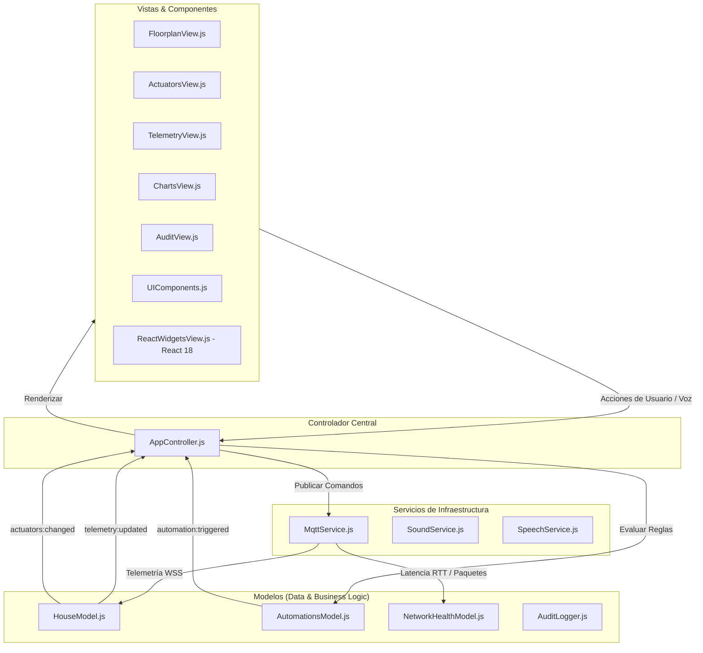

# DomótiX UAEMex — Aplicación Móvil & PC de Domótica IoT

Aplicación multiplataforma de control domótico y telemetría en tiempo real con microcontrolador ESP32. Diseñada para operar **100% de forma autónoma en Red Local (Punto de Acceso `Domotix-UAEMex` en `http://192.168.4.1`) sin depender de internet**, con soporte complementario para brokers MQTT.

Diseñada bajo una filosofía **minimalista, elegante y arquitectónica** (inspirada en Apple HomeKit y diseño escandinavo de alta fidelidad, libre de estridencias neón), con soporte funcional nativo para **Android**, **PWA** y **PC**.

---

## 📱 Modos de Ejecución Multiplataforma

### 1. Aplicación Nativa Android (Capacitor)
El proyecto cuenta con un proyecto nativo completo en la carpeta [`android/`](file:///home/alexs/Projects/IoT%20-%20IHM/android):
* **Abrir en Android Studio**:
  ```bash
  npm run android:open
  ```
* **Compilar APK de prueba (Debug APK)**:
  ```bash
  npm run android:build
  ```
* **Sincronizar cambios web al proyecto nativo**:
  ```bash
  npm run sync
  ```

### 2. Instalación como App de Escritorio (PC) y Celular (PWA)
La aplicación cuenta con `manifest.json`, Service Worker (`sw.js`) e íconos de alta resolución:
* Al abrir la aplicación en **Google Chrome, Microsoft Edge o Brave en tu PC**, verás el botón **"Instalar App"** en la barra superior o en la barra de direcciones para ejecutarla en su propia ventana sin barra de navegación.
* En **Android/iOS**, puedes abrirla en el navegador y tocar **"Agregar a la pantalla de inicio"** para usarla en pantalla completa con respuesta háptica táctil.

### 3. Servidor de Desarrollo Local
Para probarla en tiempo real en tu PC o en cualquier teléfono conectado a tu misma red WiFi:
```bash
npm run serve
```
Y accede a `http://localhost:8080` (en PC) o `http://<IP-DE-TU-PC>:8080` (en móvil).

---

---

## 🏗️ Arquitectura Modelo-Vista-Controlador (MVC) y Tecnologías

El sistema implementa una arquitectura **MVC desacoplada y reactiva** con componentes modernos basados en **React 18 & HTM** (sin necesidad de compiladores pesados ni dependencias externas, funcionando 100% offline y en Android Capacitor):



### 1. Modelos (Models)
* **[`HouseModel.js`](file:///home/alexs/Projects/IoT%20-%20IHM/js/models/HouseModel.js)**: Estado del hogar, persistencia en `localStorage`, cálculo de métricas climáticas avanzadas (sensación térmica combinada, punto de rocío de Magnus-Tetens, autonomía de agua en días y riesgo de condensación).
* **[`AutomationsModel.js`](file:///home/alexs/Projects/IoT%20-%20IHM/js/models/AutomationsModel.js)**: Reglas inteligentes autónomas con cooldowns para evitar saturación: Escudo Anti-Lluvia, Reserva Crítica de Tinaco, Ventilación Térmica y Cierre Seguro de Puerta.
* **[`NetworkHealthModel.js`](file:///home/alexs/Projects/IoT%20-%20IHM/js/models/NetworkHealthModel.js)**: Métricas de disponibilidad, latencia RTT, contadores de paquetes TX/RX, estado de conectividad del navegador (`navigator.onLine`) y cola de comandos offline.
* **[`AuditLogger.js`](file:///home/alexs/Projects/IoT%20-%20IHM/js/models/AuditLogger.js)**: Buffer circular de auditoría con exportación a formato JSON/CSV y filtrado por categoría.

### 2. Servicios de Infraestructura (Services)
* **[`MqttService.js`](file:///home/alexs/Projects/IoT%20-%20IHM/js/services/MqttService.js)**: Comunicación WSS TLS segura con **cola de comandos fuera de línea** (almacena las órdenes si no hay red y las sincroniza al reconectar), y heartbeat de medición de latencia RTT.
* **[`SoundService.js`](file:///home/alexs/Projects/IoT%20-%20IHM/js/services/SoundService.js)**: Retroalimentación auditiva sintetizada mediante Web Audio API y respuesta háptica táctil (`navigator.vibrate`) para teléfonos celulares.
* **[`SpeechService.js`](file:///home/alexs/Projects/IoT%20-%20IHM/js/services/SpeechService.js)**: Reconocimiento por voz con Web Speech API en español (*"Encender recámara"*, *"Abrir puerta"*, *"Cerrar ventanas"*, *"Modo noche"*, etc.).

### 3. Vistas (Views)
* **[`ReactWidgetsView.js`](file:///home/alexs/Projects/IoT%20-%20IHM/js/views/ReactWidgetsView.js)**: Componentes reactivos declarativos desarrollados en **React 18 & HTM**:
  * **Tarjeta de Confort y Recursos**: Sensación térmica (°C), punto de rocío y barra de reserva hídrica domiciliaria.
  * **Hub de Automatizaciones**: Interruptores táctiles para activar o desactivar reglas inteligentes autónomas.
  * **Diagnóstico de Red**: Calidad de señal, latencia RTT en ms, paquetes en sesión y selector de brokers de alta disponibilidad.
* **[`FloorplanView.js`](file:///home/alexs/Projects/IoT%20-%20IHM/js/views/FloorplanView.js)**: Plano SVG 2D con animaciones de apertura angular de puerta (0° a 90°), lamas de persianas, lluvia y pulso líquido del tinaco.
* **[`ActuatorsView.js`](file:///home/alexs/Projects/IoT%20-%20IHM/js/views/ActuatorsView.js)**: Interruptores táctiles con brillo ambiental y escenas predefinidas (*Todas On, Todas Off, Noche, Salir*).
* **[`TelemetryView.js`](file:///home/alexs/Projects/IoT%20-%20IHM/js/views/TelemetryView.js)**: Celdas métricas con soporte de fallback y cálculo de capacidad en litros.
* **[`ChartsView.js`](file:///home/alexs/Projects/IoT%20-%20IHM/js/views/ChartsView.js)**: Visualización continua de curvas Bézier en Canvas nativo.
* **[`AuditView.js`](file:///home/alexs/Projects/IoT%20-%20IHM/js/views/AuditView.js)**: Consola de paquetes con filtros por categoría (*Telemetría, Órdenes, Alertas*) y vaciado.
* **[`UIComponents.js`](file:///home/alexs/Projects/IoT%20-%20IHM/js/views/UIComponents.js)**: Pestañas adaptativas, indicador de latencia, banner offline, modales de configuración y notificaciones toast.

### 4. Controlador (Controller)
* **[`AppController.js`](file:///home/alexs/Projects/IoT%20-%20IHM/js/controllers/AppController.js)**: Orquestador central encargado de enlazar eventos del modelo a las vistas, despachar órdenes hacia los servicios y gestionar el ciclo de simulación demo.

---

## ⚡ Alta Disponibilidad y Resiliencia (High Availability)

1. **Multi-Broker Failover**: Selección en caliente entre servidores broker públicos WSS (HiveMQ, EMQX Cloud, Eclipse Mosquitto) sin recargar la aplicación.
2. **Cola de Acciones Fuera de Línea (Offline Queue)**: Si se pierde la conexión WiFi o de datos, las órdenes del usuario se conservan localmente y se transmiten automáticamente en cuanto se restablece el socket MQTT.
3. **Persistencia Instantánea**: Almacenamiento en caché de la última telemetría en `localStorage` para evitar pantallas en blanco durante la carga inicial.
4. **Service Worker (`domotix-v3`)**: Caching con estrategia *Stale-While-Revalidate* y librerías vendor locales (`js/vendor/`) que garantizan funcionamiento total sin conexión a internet.
5. **Detección Automática de Red**: Aviso discreto mediante banner cuando el dispositivo entra o sale de cobertura.

---

## 👥 Integrantes
- **Arcos Gómez Eduardo**
- **Núñez de los Santos Yael Alejandro**
- **Tovar Espinoza Fernando de Jesus**


